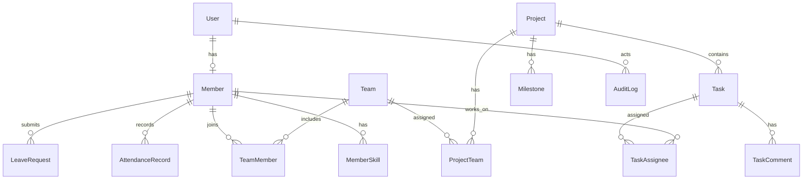

# Database ERD

> Phase 0 base ERD. Full module coverage (documents, meetings/minutes/action-items, communication, announcements targets/receipts, knowledge, notifications/preferences, achievements/feedback, permissions mappings, project history, progress entities, etc.) will be expanded in Phase 1+.
